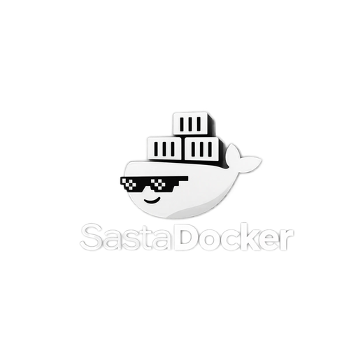

<div align="center">



# Sasta Docker

**Docker, rebuilt in Rust. Same commands, a fraction of the weight.**

Real Linux containers, a desktop app, a Docker-compatible Engine API and Compose.
One small static binary. No always-running daemon.

<p>
  <a href="https://github.com/Bhavya-Dhanwani/DOCKER/releases/latest"></a>
  
  
  <a href="LICENSE"></a>
</p>

<p>
  <a href="#-install"><b>Install</b></a> &nbsp;&middot;&nbsp;
  <a href="#-how-to-use"><b>How to use</b></a> &nbsp;&middot;&nbsp;
  <a href="#-features"><b>Features</b></a> &nbsp;&middot;&nbsp;
  <a href="#-tech-stack"><b>Tech stack</b></a> &nbsp;&middot;&nbsp;
  <a href="#-platforms"><b>Platforms</b></a> &nbsp;&middot;&nbsp;
  <a href="#-testing"><b>Testing</b></a>
</p>

</div>

---

## Why Sasta Docker

<table>
<tr>
<td width="33%" valign="top">

### Still `docker`
The command is called `docker`, so your scripts, Dockerfiles and compose files keep working. The desktop app is `docker-gui`.

</td>
<td width="33%" valign="top">

### Light on RAM
No daemon. `--mem` is a hard cgroup cap with swap off, and the Linux engine is about 1.4 MB.

</td>
<td width="33%" valign="top">

### Light on SSD
Layers are stored once and shared. Container writes go to RAM by default, so nothing hits your disk unless you mount a volume.

</td>
</tr>
</table>

---

## 📦 Install

### One line

| OS | Command |
|---|---|
| **Linux** and **macOS** | `curl -fsSL https://raw.githubusercontent.com/Bhavya-Dhanwani/DOCKER/main/install.sh \| sh` |
| **Windows** (PowerShell) | `irm https://raw.githubusercontent.com/Bhavya-Dhanwani/DOCKER/main/install.ps1 \| iex` |
| **Windows** (CMD) | `powershell -NoProfile -ExecutionPolicy Bypass -Command "irm https://raw.githubusercontent.com/Bhavya-Dhanwani/DOCKER/main/install.ps1 \| iex"` |

On Windows these commands download the installer without the browser, so Windows does not show its "Windows protected your PC" screen. The `.exe` is not code-signed (that costs money): if you download it in a browser and SmartScreen warns, click **More info**, then **Run anyway**.

### Or download

| OS | Download | What you get |
|---|---|---|
| **Windows** x64 | [SastaDocker-Setup-x64.exe](https://github.com/Bhavya-Dhanwani/DOCKER/releases/latest/download/SastaDocker-Setup-x64.exe) | `docker` and `docker-gui` on your PATH, a Start menu shortcut, and an optional "set up the Linux engine now" step (needs WSL2). Per-user, no admin |
| **Windows** ARM64 | [SastaDocker-Setup-arm64.exe](https://github.com/Bhavya-Dhanwani/DOCKER/releases/latest/download/SastaDocker-Setup-arm64.exe) | the same |
| **Linux** x86_64 | [sasta-docker-linux-x86_64.tar.gz](https://github.com/Bhavya-Dhanwani/DOCKER/releases/latest/download/sasta-docker-linux-x86_64.tar.gz) | unpack, then `sudo ./install.sh` puts both programs in `/usr/local/bin` and adds a menu entry |
| **Linux** ARM64 | [sasta-docker-linux-aarch64.tar.gz](https://github.com/Bhavya-Dhanwani/DOCKER/releases/latest/download/sasta-docker-linux-aarch64.tar.gz) | the same |
| **macOS** Apple silicon | [SastaDocker-macos-aarch64.pkg](https://github.com/Bhavya-Dhanwani/DOCKER/releases/latest/download/SastaDocker-macos-aarch64.pkg) | both programs in `/usr/local/bin`; containers run in a small VM: `brew install lima`, then `docker vm init` |
| **macOS** Intel | [SastaDocker-macos-x86_64.pkg](https://github.com/Bhavya-Dhanwani/DOCKER/releases/latest/download/SastaDocker-macos-x86_64.pkg) | the same |

> **The Windows installer asks for two folders:** where to install the program, and where to keep images, containers and the Linux VM disk, which can grow to many GB (default `%LOCALAPPDATA%\rust-docker`; pick another drive if C: is small). For a silent install use `/DIR=... /DATADIR=...`. Uninstalling keeps the data folder.

<details>
<summary><b>Remove it</b></summary>

Windows: Settings → Apps → Sasta Docker. Linux and macOS:

```sh
curl -fsSL https://raw.githubusercontent.com/Bhavya-Dhanwani/DOCKER/main/install.sh | sh -s -- --uninstall
```
</details>

---

## 🚀 How to use

### 1. First run

| OS | Do this once |
|---|---|
| **Linux** | nothing. Run as root (`sudo docker ...`), or as a normal user with `docker --rootless ...` |
| **Windows** | `docker vm init` (needs WSL2; sets up a small hidden Linux VM named `rust-docker`) |
| **macOS** | `brew install lima`, then `docker vm init` |

```sh
docker run alpine echo hello      # pulls alpine automatically, then runs it
docker-gui                        # the desktop app
```

### 2. Everyday commands

```sh
docker pull alpine
docker run --mem 64 --cpus 0.5 alpine echo hello          # hard RAM and CPU caps
docker run -d --name web -p 8080:80 -v ./site:/usr/share/nginx/html:ro nginx:alpine
docker ps
docker logs -f web
docker exec -it web sh
docker stop web && docker rm web
```

### 3. Build your own image

```sh
docker build -t myapp:1 .
docker run --rm -p 3000:3000 myapp:1
docker push myuser/myapp:1
```

### 4. Compose

```sh
docker compose up -d            # start everything in docker-compose.yml
docker compose ps
docker compose logs -f
docker compose down             # add -v to also remove volumes
```

Database data in named volumes survives `down` and `up`.

### 5. Desktop app

Run `docker-gui`. It shows containers with live RAM, disk and CPU bars, images, volumes, networks and a Live tab with every container side by side. You can pull, run, build, start, stop and read logs with clicks. Dark and light themes.

### 6. Other Docker tools

```sh
docker daemon --host unix:///tmp/docker.sock      # the Docker Engine API, for other tools
```

The real Docker CLI and the Docker SDK for Python work against it.

<details>
<summary><b>Keep WSL2's memory small (Windows)</b></summary>

The Linux engine runs in WSL2, which takes RAM from Windows. Cap it and let it give memory back with `%USERPROFILE%\.wslconfig`, then run `wsl --shutdown`:

```ini
[wsl2]
memory=3GB
[experimental]
autoMemoryReclaim=gradual
```
Without WSL2 the app runs in native mode and uses no VM memory at all.
</details>

---

## ✨ Features

<details open>
<summary><b>Containers</b></summary>

- `run` with `-d -it --name -e --env-file -v --mount -p -P --network --hostname --add-host --mem --cpus --pids-limit --restart --rm --entrypoint -w -u --health-* --cap-add/--cap-drop --security-opt --privileged --label --dns --init --read-only --ulimit --tmpfs --shm-size --volumes-from --stop-signal --stop-timeout --pull --platform`
- `ps`, `images`, `inspect`, `logs`, `exec` take Docker's options and print Docker-shaped output, including `--format` Go templates, `table`, `json` and `--filter`
- `info`, `events`, `create`, `diff`, `commit`, `export`, `import`, `port`, `attach`, `stop -s`, `kill -s`, `system prune`, `wait`, `top`, `rename`, `cp`, `stats`, `update`
- `rm`, `stop`, `start`, `restart`, `kill`, `pause`, `unpause`, `rmi` take several names
- Restart policies and healthchecks; containers get `HOME` and `PATH` like Docker's
</details>

<details>
<summary><b>Images and builds</b></summary>

- `pull`, `push`, `login`, `tag`, `rmi`, `save`/`load`, `prune`, `search`, `history`, `image inspect`; pull by digest, zstd layers, resumable pushes, credential helpers
- `build`: multi-stage, `.dockerignore`, `--target`, `--build-arg`, `--no-cache`, `COPY --from/--chown/--chmod`, wildcards, `ADD` from a URL or archive, `RUN --mount`, heredocs, `HEALTHCHECK`, `ONBUILD`, content-hash layer cache. `buildx build` works as an alias
- Layers are stored once and shared between images
</details>

<details>
<summary><b>Networking and storage</b></summary>

- A bridge with one veth per container and NAT to the internet; IPv6 inside the bridge
- `-p [ip:]host:container[/tcp|udp]`, port ranges, `--network bridge|host|none`
- User-defined networks with container-name DNS and aliases; `network create --subnet`, `connect`, `disconnect`
- Named volumes and bind mounts
</details>

<details>
<summary><b>Compose</b></summary>

- `up`, `down`, `ps`, `logs`, `config`, `build`, `exec`, `run`, `stop`, `start`, `restart`, `kill`, `pause`, `rm`, `pull`, `push`, `top`, `port`, `images`, `ls`, `cp`, `events`, `create`
- Several `-f` files and the automatic override file, profiles, `--env-file`, `secrets:` and `configs:`, `env_file`, `${VAR:-default}`, `.env`, YAML anchors, long-form volumes and ports, healthchecks and `depends_on`
- `compose watch` is not supported
</details>

<details>
<summary><b>Swarm-lite (single node)</b></summary>

- `swarm init|leave`, `service create|ls|ps|logs|scale|update|rollback|rm`, `stack deploy|ls|ps|rm|config`, `node`, `secret`, `config`
- Replicas, rolling updates and round-robin load balancing of published ports
- More than one node (`swarm join`) is not supported
</details>

<details>
<summary><b>Rootless mode (Linux)</b></summary>

- `docker --rootless ...` runs without root: user namespaces, its own layer store, networking through `slirp4netns` or `pasta`, TCP and UDP `-p`
- `build` works rootless too. Containers on one user-defined network share a network namespace, so they share one set of ports
</details>

<details>
<summary><b>Security (Linux)</b></summary>

- Docker's default capability set, a seccomp denylist, `no_new_privs`, `USER` honoured, hardening re-applied by `exec`
</details>

<details>
<summary><b>Any image works</b></summary>

`docker run <image>` pulls from Docker Hub or any registry when needed. Intel-only (x86-64) images run on ARM64 machines through built-in emulation (about 6 times slower than native on a CPU-bound test); on Intel and AMD PCs they run natively.

**43 images run and checked:** alpine, ubuntu, debian, busybox, fedora, kali, archlinux · node, python, golang, rust, php, ruby, java, .NET · nginx, httpd, caddy, traefik, haproxy · postgres, mysql, mariadb, mongo, redis, memcached, cassandra, couchdb, influxdb · rabbitmq, nats, redpanda, mosquitto · wordpress, ghost, grafana, prometheus, vault, registry, mailhog, adminer · jenkins, gitea

**Languages checked** (compile and run a program in each): Python, Node.js, Bun, Deno, Go, Rust, Java, PHP, Ruby, Perl, C, C++, Lua, Elixir, .NET, R, Haskell, Kotlin
</details>

---

## 🧰 Tech stack

<table>
<tr><th align="left">Area</th><th align="left">What is used</th></tr>
<tr><td><b>Language</b></td><td>
 Cargo workspace of four crates, static musl binaries, <code>opt-level=z</code> + LTO + strip
</td></tr>
<tr><td><b>Desktop app</b></td><td>
  immediate-mode GUI, X11 and Wayland on Linux
</td></tr>
<tr><td><b>Containers (Linux)</b></td><td>
 namespaces (PID, mount, UTS, IPC, net, user), <code>pivot_root</code>, cgroup v2, overlayfs, seccomp, capabilities
</td></tr>
<tr><td><b>Networking</b></td><td>
Pure-Rust netlink and nftables, bridge + veth pairs, NAT, <code>slirp4netns</code> / <code>pasta</code> for rootless
</td></tr>
<tr><td><b>Images and registries</b></td><td>
 Docker Registry HTTP API v2, manifests and layers, zstd and gzip, <code>curl</code> for transfers
</td></tr>
<tr><td><b>Compatibility</b></td><td>
Docker Engine API over a Unix socket or TCP, Docker CLI options and Go-template <code>--format</code>, Compose file format, Dockerfile syntax
</td></tr>
<tr><td><b>Windows</b></td><td>
 a hidden WSL2 distro runs the Linux engine; Job Objects for the native fallback;  installer
</td></tr>
<tr><td><b>macOS</b></td><td>
 Lima VM, <code>pkgbuild</code> packages
</td></tr>
<tr><td><b>Emulation</b></td><td>
 qemu-user through <code>binfmt_misc</code> for Intel images on ARM
</td></tr>
<tr><td><b>Build and release</b></td><td>
 builds Windows (x64, ARM64), Linux (x64, ARM64) and macOS (Intel, Apple silicon) installers, plus one-line <code>install.sh</code> and <code>install.ps1</code>
</td></tr>
<tr><td><b>Data formats</b></td><td>
JSON (<code>serde</code>), YAML, TOML, tar
</td></tr>
</table>

---

## 🖥 Platforms

| OS | How containers run |
|---|---|
| **Linux** | Native: namespaces, cgroup v2, overlayfs, `pivot_root`. Run as root, or rootless. |
| **Windows** | The same engine inside a small hidden WSL2 distro: `docker vm init` once, then use the CLI as on Linux (`docker run -v C:\data:/data ...` works; paths are translated). **Without WSL2** the app still runs in native mode: `docker run <folder> <program>` runs a Windows program under a Job Object with memory and CPU caps. |
| **macOS** | The same engine in a Lima VM. The driver is written and compiled but has not been tried on a real Mac yet. |

---

## 🧪 Testing

- Unit tests for every crate: `cargo test --workspace`
- End-to-end suites in `scripts/` (Linux, run as root, offline): containers, networking (TCP/UDP/IPv6/subnets), user-defined networks, builds, security, registry, save/load, compose, terminals and healthchecks, Swarm-lite, Engine API, rootless
- `scripts/e2e-realcli.sh` runs the real Docker CLI against our daemon; `scripts/e2e-sdk.sh` runs the Docker SDK for Python
- `scripts/e2e-vm.ps1` checks Windows to the Linux VM
- `scripts/live-images.sh` and `scripts/live-languages.sh` pull and run the images and languages listed above
- `scripts/build-all-projects.ps1` builds every Dockerfile and compose file under a folder and prints one PASS/FAIL line each
- Every tab, dialog and button of the desktop app was clicked through on Windows

## 🔨 Build from source

```powershell
scripts\build.ps1    # tests, then the Windows CLI + GUI and the Linux engine (docker-linux-<arch>)
```
```sh
cargo build --release -p docker-cli --target x86_64-unknown-linux-musl     # or aarch64-unknown-linux-musl
```

---

<div align="center">

MIT licensed, see [LICENSE](LICENSE) &nbsp;·&nbsp; progress log: [ROADMAP.md](ROADMAP.md)

<sub>Made by <a href="https://github.com/Bhavya-Dhanwani">Bhavya Dhanawani</a></sub>

</div>
